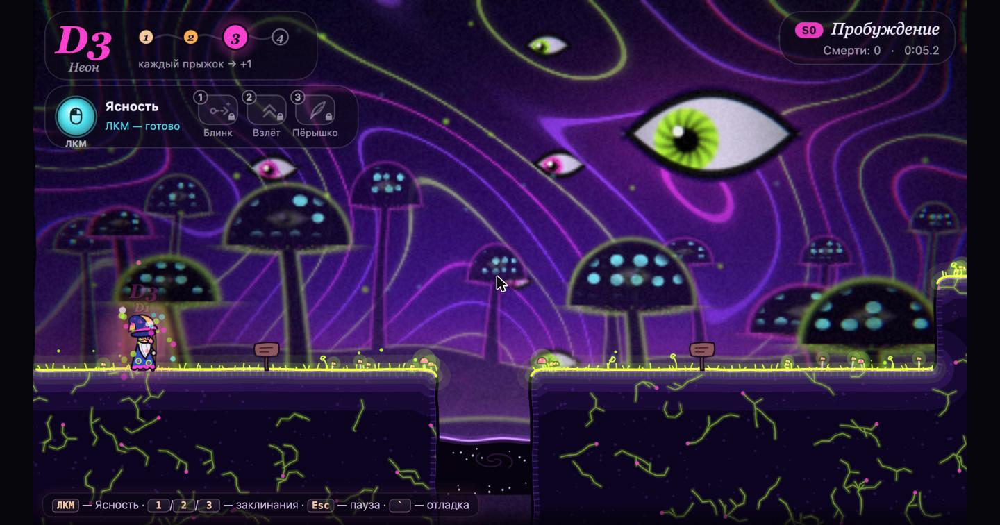

# Mushroom Wizard (Грибной волшебник)

A 2D platformer prototype about a wizard on mushrooms. Every jump makes him drunker; a short window of Clarity gives back control and one spell.

[](https://iansilent.github.io/mushroom-wizard/)

**[▶ Play in the browser](https://iansilent.github.io/mushroom-wizard/)** · keyboard and mouse · UI in Russian

## The idea being tested

Can one character be fun to control in two opposite states, and is switching between them an interesting decision?

- **Drunk** is the default. There are four stages, D1 to D4. Every jump raises the stage by one. Jumps get higher and floatier, the ground gets slippery, and the wizard starts to sway and hiccup. Only jumps raise the stage; time never does.
- **Clarity** lasts a few seconds. Jumps are low and precise, and you may cast one spell: Blink, Levitate or Feather fall. Casting ends Clarity at once.

Each stage repaints the whole world, so you always see how far gone you are.

## Controls

| Action | Input |
|---|---|
| Move, aim a spell | Arrows or WASD |
| Jump | Space / Z / J |
| Clarity | Left mouse button, or X / K |
| Spells (one per Clarity) | 1 Blink, 2 Levitate, 3 Feather fall |
| Back to checkpoint | R |
| Pause and settings | Esc |
| Debug panel with live tuning | ` |

## What is inside

- Eight short rooms that teach the stages and the spells one by one, plus a sandbox.
- A debug panel where every movement number is a slider.
- [DESIGN.md](DESIGN.md): the mechanics, the level design rules and the art direction.

## Run locally

Plain HTML, CSS and JavaScript on a canvas. No build step and no dependencies.

```bash
python3 -m http.server 8765
```

Then open http://localhost:8765. Double-clicking `index.html` also works in most browsers.

## Checks

Every room has a scripted solution that is replayed headlessly, also under timing noise:

```bash
node tools/check.js
```
